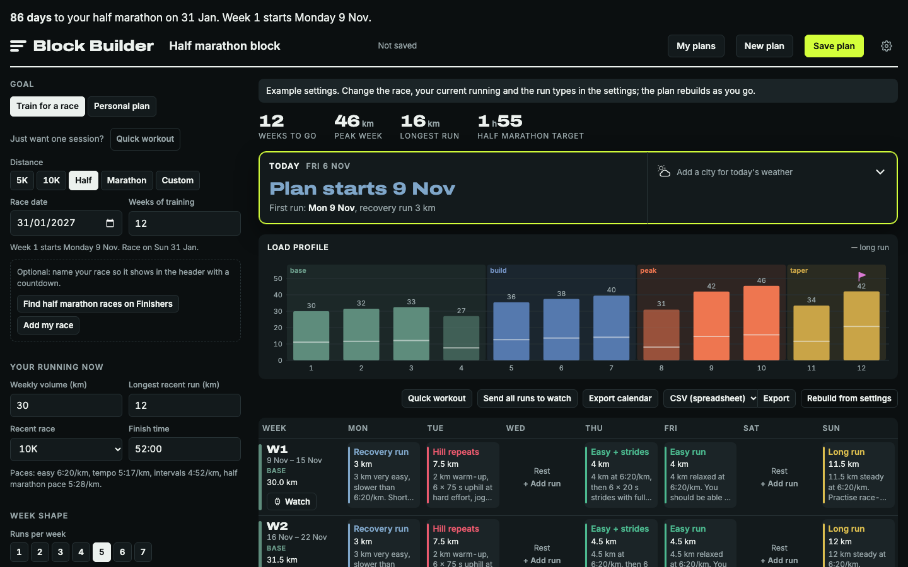

# Block Builder

[](https://github.com/arthurfranck/block-builder/actions/workflows/tests.yml)

Plan a running training block in your browser and send every run to your watch. Pick a race or a personal goal, enter your current running and choose your run types: Block Builder lays out the weeks, the volume and every run.

**[Open the app](https://arthurfranck.github.io/block-builder/)** · [How to use it](#how-to-use-it) · [Features in detail](docs/features.md) · [Run locally](#run-locally) · [Changelog](CHANGELOG.md)



## How to use it

1. **Pick a goal:** a race (5K to marathon, or a custom distance) with its date, or a personal plan over a set number of weeks.
2. **Enter your running now:** experience, weekly volume (suggested from your experience and distance; change it to what you run), longest recent run if you know it (optional) and, for paces, a recent race time; then your week: runs per week, days and the run types you want. On a phone, New plan walks you through these as 4 steps.
3. **Use the plan:** edit any run, then send a run, a week or the whole plan to Apple Watch or Garmin, or export it as a calendar, spreadsheet or PDF. Your plan saves itself as soon as it can be built; the ▾ next to its name opens My plans. The example plan is only kept if you press Keep this plan.

Just want one session? **Quick workout** builds a single run and sends it to your watch without touching the plan.

## Features

For runners. Every rule and number is in [Features in detail](docs/features.md).

- **Goals:** race (5K, 10K, half, marathon, custom) or personal plan, with a warning when a half or marathon plan peaks too low, and optional easy recovery weeks after race day.
- **Sound plans:** base, build, peak and taper phases, cutback weeks and hard runs set by your experience level (new, regular, experienced), +10% a week at most, and a long run kept to a share of the week, a maximum duration and a steady growth.
- **Paces:** easy, tempo, interval and race paces from a recent race result.
- **Run types:** nine built in (easy to race pace), each saying why it is there and how it should feel, plus your own, with editable descriptions.
- **Checks:** warnings for too many hard runs in a week, hard runs next to each other or the long run, and running days with no rest; a warning about a setting shows under that setting.
- **Plan view:** summary numbers, a load profile chart by phase, and a week-by-day grid coloured by effort.
- **Editing:** edit, drag, add or delete any run, with a note per run.
- **Today card:** today's run with its workout bar and paces, one-tap Send to watch, the weather with the driest slot, and slower paces on hot days.
- **Quick workout:** one run, built and sent in seconds, optionally added to the plan.
- **Race countdown:** optional, with a link to the race page.
- **Exports:** Apple Watch (`.workout`), Garmin and other devices (`.fit`), calendar (`.ics`), spreadsheet (`.csv`) and printable PDF.
- **Your way:** English or French, dark, light or auto theme, phone layout with a card per week, keyboard and screen reader support.

## Privacy and storage

There are no accounts, no server and no tracking. Everything stays in your browser (`localStorage`):

| Key | Holds |
|---|---|
| `bb-plans` | your saved plans |
| `bb-theme`, `bb-lang` | theme and language |
| `bb-device` | the last watch you sent to |
| `bb-export-fmt` | the last plan export format |
| `bb-wx`, `bb-wx-open` | the weather city, and whether the forecast is open |
| `bb-quick-unit`, `bb-quick-paces`, `bb-quick-recent` | quick workout unit, its recent race, and the last 5 quick workouts |
| `bb-backup` | when plans were last saved to a file, the first change since, and until when Later hides the reminder |

**My plans → Save plan** downloads every plan as one JSON file, and **Import** loads it back on any device or browser. Imported files are checked field by field and cleaned before they are stored, so a file from someone else can't inject anything into the page. Importing a plan you already have never loses either version: a newer file replaces yours, and when yours is newer the file's version is added beside it. A saved plan saves itself 1.5 seconds after each change, and right away before another plan replaces it or the tab closes; leaving with a plan that was never saved asks first. A browser can delete what a site keeps (clearing site data, or Safari after 7 days of use without a visit), so the page asks the browser to keep its storage once a plan is saved, My plans says when plans were last saved to a file, and the plan shows a reminder when saved plans have changes not saved to a file for a week (Later hides it for a week).

The page only reaches outside for:
- Google Fonts, for the type;
- [Open-Meteo](https://open-meteo.com) (free, no key), once you set a city or use your location;
- cdnjs, for the PDF library, only when you export a PDF.

## How it's built

I run Block Builder as a team lead. I make the product, design and technical decisions. AI agents (Claude Code) do the work of the product managers, designers and engineers. Everything the team does goes through this repo, so you can follow the whole loop.

**My part**
- **Product:** what to build and in what order. I keep a scored backlog, ranked so that nothing is built before an item that would rework it, and I pick each next item. The training rules come from audits of generated plans against five athlete profiles, from a beginner to an experienced marathoner.
- **Design:** every flow and screen. For bigger changes the team mocks up options and I choose.
- **Tech:** the architecture and the working rules in [CLAUDE.md](CLAUDE.md), which serves as the team handbook: what every change must include, what is never allowed, and how a release is made.
- **Merge:** a change reaches `main` only when I merge it, and only after CI is green.

**The AI team's part**
- **Product manager:** writes a brainstorm for each backlog item before any plan ([docs/brainstorms/](docs/brainstorms/)).
- **Designer:** mock-ups and options for screen changes.
- **Engineer:** the code, tests, docs and changelog for one backlog item per branch and pull request (`BB-<n>`).
- **Ops:** a weekly codebase health check that reports trends and risks against a profile ([.claude/health.md](.claude/health.md)).

**Guardrails that make delegating safe**
- `main` is protected: type checks, a dependency audit and the tests on six desktop and iPhone setups must all pass.
- A pre-commit hook runs the engine and Chrome tests before any commit that touches the app.
- A behaviour change comes with a test change, and a failing test is never deleted or loosened: the page gets fixed.
- The plan engine has no DOM and no storage, so every training rule is unit-tested in Node.
- Each release bumps the version, adds a changelog entry and updates the docs in the same commit.

## For developers

### Repository map

```text
index.html            the page: HTML and CSS
app.js                the interface: rendering, storage, exports
theme.js              sets the theme before the page paints
engine.js             the plan engine: paces, plan building, warnings, week checks (no DOM, no storage)
vendor/               third-party code served from this repo (see vendor/README.md)
docs/                 features in detail, architecture decisions (adr/), brainstorms per backlog item, README screenshot
tests/                Playwright browser tests, Node engine tests, test server (see tests/README.md)
.github/              CI workflow and Dependabot
.claude/              Claude Code setup (see CLAUDE.md)
CHANGELOG.md          what changed in each version
CLAUDE.md             rules for working on this repo with Claude Code
```

### Tech

- No build step. `app.js`, `engine.js` and `theme.js` are classic scripts rather than ES modules so the page still works opened from disk.
- Google Fonts: Archivo (expanded and heavy) for the brand and big numbers, Inter for everything else.
- [jsPDF](https://github.com/parallax/jsPDF) 4.2.1 and [jsPDF-AutoTable](https://github.com/simonbengtsson/jsPDF-AutoTable) 5.0.9 from cdnjs, loaded only when exporting a PDF, with integrity hashes: if the CDN serves a different file, the browser refuses it.
- Vendored [`@bibixx/workoutkit`](https://www.npmjs.com/package/@bibixx/workoutkit) 0.2.0 (MIT) in `vendor/workoutkit-0.2.0/`, loaded only when exporting to Apple Watch.
- Content Security Policy (in a `<meta>` tag): scripts only from the page itself and cdnjs, styles from the page and Google Fonts, network requests only to Open-Meteo, no plugins, forms or `<base>` changes. No inline script is allowed: the app's code is in its own files, so a script injected into the page would not run. Those files are loaded with the version in the URL (`app.js?v=1.11.1`), so a new release never runs with an older cached copy.
- Hosted on GitHub Pages from the `main` branch, root folder.

### Run locally

Open `index.html` in a browser. Everything works offline except the fonts, which fall back to system fonts, the weather, the Apple Watch export and the PDF export.

To serve it the way the tests and CI do, run `node tests/serve.mjs 8765` and open http://127.0.0.1:8765/. Working on it with Claude Code: see the `.claude/` section in [CLAUDE.md](CLAUDE.md) (pre-commit test hook, preview config, `/release` command).

### Tests

```sh
npm ci && npx playwright install chromium webkit
npm test
```

`npm test` runs the engine unit tests in Node, then the browser tests on six desktop and iPhone setups. CI runs them on every push and pull request, and `main` only accepts changes that pass all six. Setups, what each file covers, CI and known issues: [tests/README.md](tests/README.md).

## Origin and differences from the claude.ai version

This is the standalone version of a Claude artifact. The claude.ai version also has:
- Claude-written coach notes
- per-user cloud saving
- a greeting with the viewer's name

All three depend on the claude.ai artifact runtime, so they were removed here. The other way round, the weather on the Today card works only here: claude.ai artifacts block outside network calls, so the forecast can't load there.

## Feedback

Found a bug or have an idea? [Open an issue](https://github.com/arthurfranck/block-builder/issues).

## Changelog

What changed in each version is in [CHANGELOG.md](CHANGELOG.md). The version shown in the page footer is the latest entry there.

---

Made by [Arthur Franck](https://github.com/arthurfranck).
